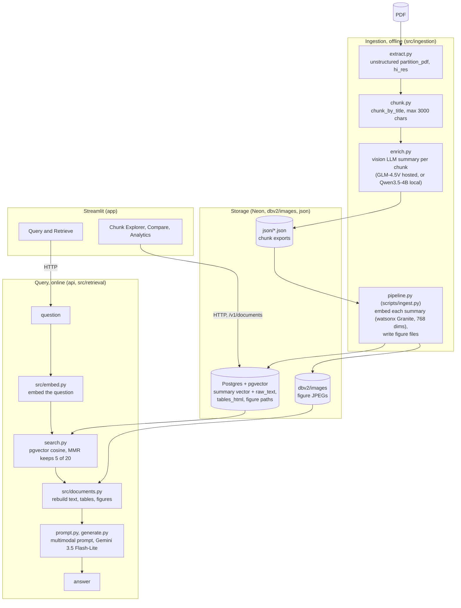

# KI-CRAFT

**An open-source, AI-assisted PCB design and EDA toolkit, built to work alongside KiCad.**

KI-CRAFT aims to bring the same help to open tools: read the datasheets for you, check your schematic against them, and, step by step, draft schematics and assist with layout.

It starts where every design starts: the datasheet. Today it answers questions about datasheets and application notes from their text, tables and figures, and shows the figure each answer relied on.

| Chunk Explorer | Dataset Analytics | Query & Retrieve |
|---|---|---|
|  |  |  |

## Who it is for

- **KiCad users tired of drawing schematics by hand** and cross-checking every pin, capacitor value and footnote against a 60-page PDF.
- **Hardware engineers** checking a design: dropout at a given load, the output voltage formula, the recommended layout, with the source figure to verify against.
- **Students and makers** learning to read datasheets: what a pin does, "typical" versus "maximum", what a graph shows.
- **Teams who want an open alternative** to closed AI EDA tools, one they can run, inspect and extend.

## Status

| Phase | Goal | Progress |
|---|---|---|
| 1. Datasheet assistant | Trustworthy answers from datasheets: text, tables, figures, cited | `████░░░░░░` 40%, in progress |
| 2. Schematic review | Check a KiCad schematic against the datasheets of its parts: pins, feedback dividers, decoupling | `░░░░░░░░░░` planned |
| 3. Design agent | Draft schematics in KiCad from requirements, and assist with placement and layout | `░░░░░░░░░░` planned |

Phase 1 so far: a cleaned-up, explainable codebase, an API with streaming answers and labelled figure citations, a pipeline that ingests any PDF, and Postgres with pgvector as the one database. Next: an evaluation set that measures accuracy (drafted), hybrid search, uploading your own PDFs through the API with page-level citations, and a hosted demo.

## What it does today

- **Answers from text, tables and figures.** The model gets each relevant section's original text, its tables and its figures, not just the paragraphs.
- **Shows its evidence.** Every answer lists the figures the model saw, and cites them as `[IMG1]`, `[IMG2]`, next to the chunks it used (`[C1]`).
- **Refuses to guess.** It says when the documents do not state something, keeps units and test conditions, and never mixes values from different parts.
- **Brings your own model.** Gemini by default; any model from Gemini, OpenAI, Groq or Hugging Face with your own key.
- **Ingests new PDFs** with a hosted vision model or one that runs locally on a Mac.

Six datasheets and application notes ship ready to query: LM317, LM2596, LM555, NE555, TLV1117 and Microchip AN699.

<b>How it works</b>

A vision model writes a plain-text summary of each section of a PDF, covering its prose, tables and figures. The summaries are embedded and searched; the original text, tables and figures are stored alongside, so each answer is written from the source material, not from the summary.

## Getting started

Setup, running the API and the dashboard, ingesting your own PDFs and Docker are covered in [CONTRIBUTING.md](CONTRIBUTING.md).

## Documentation

| Document | What it holds |
|---|---|
| [CONTRIBUTING.md](CONTRIBUTING.md) | Setup, running each part, ingestion, Docker, configuration, and conventions for changes |
| [docs/TRADEOFFS.md](docs/TRADEOFFS.md) | Why each component is built the way it is, and what was considered instead |
| [docs/PRODUCT_RESEARCH.md](docs/PRODUCT_RESEARCH.md) | What people designing with datasheets need, existing tools, and where this project can stand out |

## Contributing

Issues and pull requests are welcome. Start with [CONTRIBUTING.md](CONTRIBUTING.md), or open a [GitHub issue](https://github.com/moksh-m9u/Multimodal-Rag/issues) to discuss an idea.

## License

[Apache 2.0](LICENSE)
